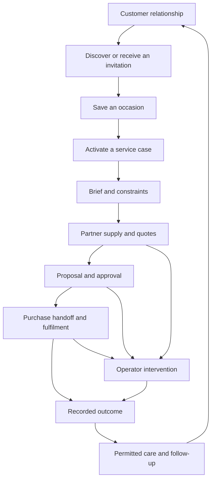
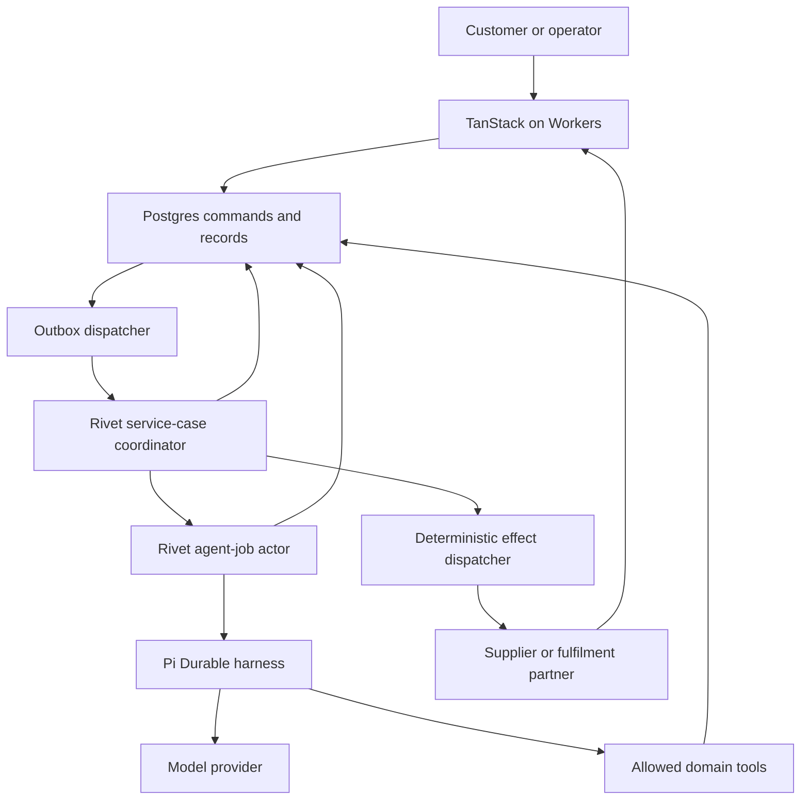
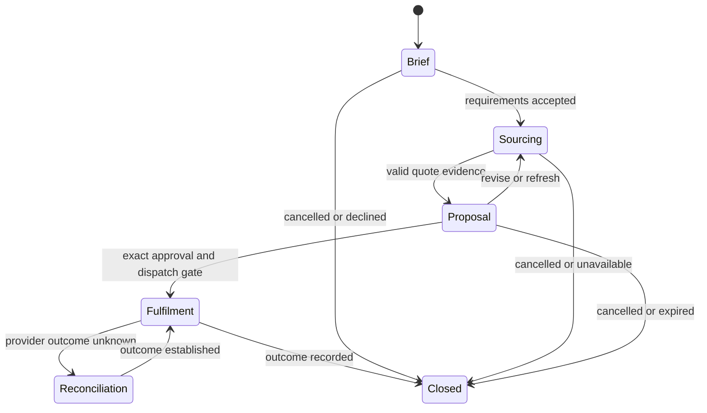

# Customer lifecycle and agent execution

Status: implementation specification, 27 November 2026. The executable fixtures demonstrate selected contracts; they do not establish a deployed commerce service. Read the [harness decision](adr/0005-agent-harness.md) and [implementation handoff](implementation-handoff.md) with this document.

## The decision

Use **Rivet Cloud for the application runtime**, a **deterministic coordinator for each service case**, and **Pi Durable through `@rivet-dev/pi` for bounded reasoning jobs**. Postgres remains the authority for commercial records. The Pi integration is a qualified PoC candidate with pinned dependencies; its Cloud deployment and commercial failure boundaries still need verification.

This creates two kinds of actor in the same Rivet application. The case coordinator decides which business operation is permitted. An agent-job actor performs a bounded piece of reasoning and returns a candidate result. Pi Durable owns the inner model/tool checkpoints. It does not decide whether a purchase was authorized or fulfilled.

The coding agent used to develop this repository is independent of the harness embedded in Occavoy. A developer may use any compatible coding assistant. Production customers do not get that assistant's developer shell, repository credentials, or personal MCP connections.

## Four lifetimes and one effect record

| Object                | Identity               | Lives for                                                       | Authority and purpose                                                                     |
| --------------------- | ---------------------- | --------------------------------------------------------------- | ----------------------------------------------------------------------------------------- |
| Customer relationship | tenant + customer      | Many occasions and cases                                        | Postgres: preferences, consent, channel grants, service history and follow-up eligibility |
| Service case          | tenant + case          | An activated request through its documented outcome             | Postgres commercial state; one Rivet coordinator advances the permitted work              |
| Conversation          | case + conversation    | A communication thread, possibly many turns                     | Saved messages and presentation; it is not approval or booking authority                  |
| Agent job             | tenant + case + job    | One assigned reasoning objective, with a deadline and allowance | Pi Durable checkpoints inside a Rivet actor; result is bound to the input case revision   |
| External action       | tenant + case + action | Dispatch intent through confirmed or unresolved outcome         | Postgres effect ledger plus provider evidence; one stable provider reference              |

One customer may have two active cases. One case may need several agent jobs. A saved occasion does not start a paid background loop. A new customer message does not necessarily require a model: explicit cancel, approve, status and supplier callbacks are deterministic commands.

## The customer and partner loop

The relationship continues when a case closes. Follow-up creates a new opportunity or a new case; it does not reopen an old purchase approval. A channel partner receives only the grants associated with its project. Payment responsibility, customer-data access and fulfilment responsibility are separate facts.

For the first partner demonstration, use one synthetic Hong Kong customer interested in a London performance. The same contracts must accept Tokyo or Singapore. A manual supplier form can return a quote. The system must identify the seller and fulfiller even when the partner response is manually entered.

## Deployment and invocation

The outbox dispatcher and effect dispatcher are application modules, not additional workflow platforms. Start with one Workers deployment and one Rivet Node application. Workers schedules may scan due database records and notify actors; they do not become a second owner of a case. R2 stores selected evidence through the existing 8 GB quota boundary.

### A concrete invocation sequence

1. The authenticated web boundary accepts a command such as `activate_case` or `revise_brief`. It derives the tenant and actor identity from authentication, not from the model or an unchecked request body.
2. A Postgres transaction records the command and an outbox item. The HTTP request returns `202 Accepted` with the command ID. Acceptance means the command is durable, not that a quote or booking exists.
3. The dispatcher delivers the command at least once to the case coordinator. The coordinator obtains the current case revision and identifies the next deterministic action.
4. If reasoning is needed, the coordinator records an agent-job specification and a stable submission request ID. The job contains the exact case revision, task purpose, permitted inputs, tool profile, deadline, model policy and execution allowance.
5. Backend code obtains the Pi actor by `[tenantId, caseId, jobId]` and invokes its **`submit` action**, passing the same `requestId` on every transport retry. `submit` returns a submission ID without holding the original customer request open.
6. Pi runs its model/tool loop. The selected tools can read the scoped case snapshot, inspect permitted event/supply data, and produce a structured candidate. The initial tool profile has no shell, arbitrary HTTP, booking, payment, or unrestricted database tool.
7. The coordinator observes completion, validates the structured result, and commits it only if the tenant, case, job and expected revision still match. A result from an older brief is recorded as stale; it cannot replace newer work.
8. The customer reads persisted progress. A lost browser connection or a missed streaming update does not lose the case.

The SDK invocation form is documented by [Rivet's Pi integration](https://rivet.dev/ecosystem/pi-durable/): `handle.submit(text, { requestId })` starts work; `handle.prompt(text, { requestId })` also waits. A caller timeout does **not** cancel the run. Explicit conversation abort is required, and a business cancellation must also fence late results and future external actions. The local `verify:harness` command exercises the installed SDK; application command and database paths above are the next integration work.

Do not call `spawn("pi", ...)` per web request. That would give the application a CLI lifecycle and working directory to manage while bypassing the selected actor/session integration. CLI, RPC and SDK are invocation choices, not substitutes for the application's authorization and commercial state.

### Tools, MCP and instructions

A domain tool is an application function with a schema, trusted scope and execution policy. The harness chooses when to call it; the function performs the allowed work. Initially these functions run in the Node application and call the domain/repository or a bounded provider adapter. An MCP server is an optional way to expose an external tool provider. It does not supply the case lifecycle, permissions, approval records or transaction recovery.

Development MCP connections are for contributors. Customer jobs get their own explicitly configured capabilities. The production system prompt and any task skills must be loaded deliberately, versioned with the task policy and kept separate from root `AGENTS.md`, which instructs the coding agent working on this repository.

## Where a model is useful

| Trigger                            | Model work                                       | Deterministic work after it                                              | What wakes the next stage                  |
| ---------------------------------- | ------------------------------------------------ | ------------------------------------------------------------------------ | ------------------------------------------ |
| Case activated with missing detail | Identify ambiguity and draft a question          | Validate missing fields and save the question                            | Customer's next command                    |
| Sufficient brief and event choice  | Extract requirements; rank feasible candidates   | Reject impossible dates, unsupported supply and inconsistent money       | Requirements accepted or operator decision |
| Supply needs identified            | Draft RFQ content if useful                      | Persist RFQ; dispatch through an approved partner route                  | Supplier callback or manual response       |
| Valid quotes received              | Explain trade-offs and draft proposal narrative  | Assemble immutable terms from validated quote versions                   | Customer approval, revision or expiry      |
| Exact proposal approved            | Usually no model required                        | Recheck approval, reserve effect and dispatch to actual seller           | Provider confirmation or reconciliation    |
| Outcome or service exception       | Summarize evidence and suggest a response        | Decide allowed transition, assign operator and deliver authorized notice | Operator action or provider evidence       |
| Case closed                        | Draft permitted follow-up when there is a reason | Apply consent, channel scope and contact policy                          | Customer response or a new case            |

Waiting for a hotel, customer, event date or operator does not leave an LLM thinking. Store the waiting reason and deadline, stop the reasoning run, and wake the case on an event or scheduled check. Human approvals are business records outside a model transcript.

## Business states are not model states

A case has a stable phase and an independent waiting reason. Its component orders, payments and fulfilment records have their own states. In particular, payment success does not mean booked, a supplier quote does not mean held, and booking confirmation does not mean service delivered.

An unresolved external obligation stays in reconciliation. Recording uncertainty is not enough to close it. This diagram summarizes business progression. The pure reference model lives in `packages/domain/src/case-lifecycle.ts`; it demonstrates one component and does not replace a transactional repository. Multi-component partial success must be implemented explicitly before assisted commercial use.

## Recovery has two different meanings

**Agent recovery** restores an interrupted reasoning job. **Business recovery** establishes what happened to a transaction or service obligation. A successful agent replay cannot establish the latter by itself.

| Failure                                                   | Recovery rule                                                                                               |
| --------------------------------------------------------- | ----------------------------------------------------------------------------------------------------------- |
| Browser closes after acceptance                           | Read command/case status from persisted records; keep execution independent of the request                  |
| Command delivered twice                                   | Return the existing result for the same ID and payload; reject conflicting reuse                            |
| Process dies during a model call                          | Pi may retry the interrupted call within the job policy; account for repeated or uncertain spend            |
| Process dies during a read tool marked replay-safe        | Replay only under the same scope and task inputs; refresh commercial data before acting                     |
| Process dies during an unsafe tool                        | Treat it as interrupted; never infer that its external effect did not occur                                 |
| Agent result arrives after a brief change or cancellation | Reject it using the case revision/job fence; retain audit evidence                                          |
| Supplier acts but its response is lost                    | Keep the external action `unknown`; query by stable reference or assign an operator                         |
| Quote expires before dispatch                             | Stop, refresh or re-propose; obtain new approval when terms change                                          |
| A completion callback is missed                           | Reconcile the persisted agent-job/submission status; callbacks are notifications, not the only result store |
| Deployment changes the harness schema                     | Qualify forward migration and in-flight recovery; do not assume an old binary can reopen newer checkpoints  |

For purchase dispatch, the critical sequence is: commit intent → contact provider → commit receipt. There is no transaction spanning Postgres and the supplier. A timeout between the latter two steps produces uncertainty. Only a provider capability, a stable idempotency key, or evidence-based reconciliation can safely resolve it.

## Scope, limits and telemetry

Every job needs `tenantId`, `caseId`, `jobId`, `baseRevision`, purpose, allowed tools, deadline, model policy and allowance. Store these server-side. The model cannot change them. Before every externally meaningful action, check current cancellation, authority, quote validity and budget again.

The qualification harness uses a scripted model provider to exercise the real SDK without paid inference. Production model selection, cumulative case-budget reservation, usage settlement and tenant authorization remain integration gates. A maximum output-token setting alone is not a case budget; retries, parallel jobs, tool fees and uncertain model spend must be counted.

Trace identifiers link customer command → case revision → agent job/submission → tool call → external action → provider receipt. A client-visible timeline is a filtered projection of these records. It must not expose raw transcripts, private supplier rates, credentials or another partner's customer history.

## What the next engineer must not infer

- A passing actor probe does not mean the customer lifecycle is implemented.
- The synthetic lifecycle scenario is not a deployed transaction system or a real inventory integration.
- Actor identity does not serialize all actions: Rivet actions can interleave, so use atomic updates and database constraints.
- Pi's request deduplication does not guarantee exactly-once provider execution.
- Inner agent durability and outer case durability are compatible when their record ownership is explicit.
- A production service must not inherit a developer's coding tools, personal credentials or automatically discovered repository instructions.

See the [handoff checklist](implementation-handoff.md) for the exact next slice and acceptance evidence.
