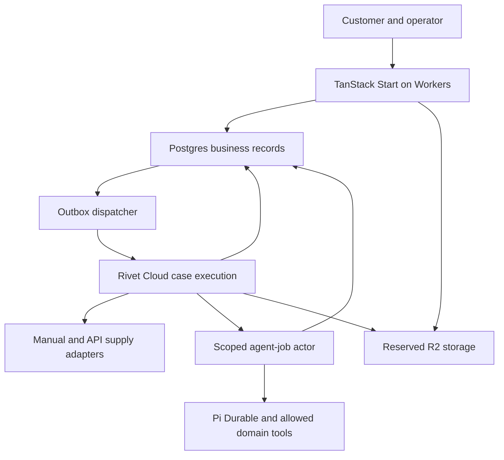

# Architecture baseline

Status: selected boundaries with implementation and cloud proof tracked separately. The [customer lifecycle and agent execution](agent-execution.md) document defines invocation, ownership and recovery. The [implementation handoff](implementation-handoff.md) distinguishes executable fixtures from the next integration work. See the [ADRs](README.md) and [release gates](roadmap.md).

## Runtime topology

| Component           | Responsibility                                                                                     | Initial deployment direction                                         |
| ------------------- | -------------------------------------------------------------------------------------------------- | -------------------------------------------------------------------- |
| `apps/web`          | TanStack Start interface, authenticated request boundary, progress and operator views              | Cloudflare Workers Paid                                              |
| `apps/runtime`      | Separate case coordinator and scoped Pi Durable agent jobs; waiting, resumption and reconciliation | Rivet Cloud Actor Nodes                                              |
| `packages/domain`   | Portable contracts and deterministic business rules                                                | Shared TypeScript package                                            |
| `packages/storage`  | Business records, transaction boundaries, storage reservations and persistence interfaces          | Postgres-backed implementation; adapters are qualified independently |
| `experiments/evals` | Reproducible fixtures, scenario evaluation, and measurement utilities                              | Python through the `uv` workspace                                    |
| R2                  | Bounded evidence and generated artifacts                                                           | Private objects behind an application upload policy                  |

The directory boundaries do not require separate deployed microservices. Use one web deployment and one Rivet application first. Add operational components only when a measured responsibility requires them.

Rivet hosts both case execution and agent-job execution. The case coordinator owns permitted business progression; Pi Durable owns the model/tool checkpoints of a particular job. Postgres remains the commercial authority. A scheduled dispatcher may run as a bounded scheduled job, but it does not create another owner of the case. The web request returns after durable command acceptance rather than waiting for a supplier reply.

## Seven logical responsibilities

1. **Catalog:** sourced event revisions, sessions, places, and participation conditions; consume a versioned Eventsquare contract where available.
2. **Relationships and channels:** customer preferences, consent, channel and project membership, payer/seller/fulfiller roles.
3. **Cases:** brief revisions, phase, waiting reason, deadlines, and operator interventions.
4. **Matching and proposals:** deterministic constraints, resource requirements, quote combinations, and immutable proposal revisions.
5. **Supply:** capability-declared adapters, asynchronous RFQs, quote versions, and evidence quality.
6. **Commerce and fulfillment:** external actions, component orders, receipts, payment observations, and changes.
7. **Operations:** timeline, exceptions, cost attribution, reconciliation, and relationship follow-up.

These are module responsibilities. Do not create seven deployable services to match this list.

## Record ownership

Postgres is the intended business authority. Case actors hold recoverable receipt/drain state and execution references; Pi actors hold scoped conversations, submissions and model/tool checkpoints in actor SQLite. R2 stores selected evidence bytes referenced by records. A development memory adapter or fixture is not a production persistence claim.

| Records                                  | Required invariant                                                                        |
| ---------------------------------------- | ----------------------------------------------------------------------------------------- |
| Event revision and evidence              | Keep provenance, global place identity, local time precision, revision, and observed time |
| Customer, consent, channel, access grant | Scope use and visibility independently from who pays                                      |
| Brief, case, requirement, RFQ            | Carry tenant, version, constraints, deadline, and responsibility                          |
| Quote and proposal versions              | Do not overwrite accepted commercial terms or imply a hold without evidence               |
| Approval                                 | Bind actor, proposal hash, scope, currency, amount, and validity                          |
| External action, order line, receipt     | Preserve a stable client reference and an explicit unknown state                          |
| Command, outbox, result                  | Acknowledged commands survive process failure and can be delivered again safely           |
| Usage and storage reservation            | Reserve atomically, settle once, and reconcile uncertain outcomes                         |

Use a stable case phase such as `draft`, `qualifying`, `sourcing`, `proposing`, `fulfilling`, or `closed`. Track blocking reasons separately. Order, payment, fulfillment, and refund state remain independent: none implies the others.

## Command and effect path

1. Authenticate at the server boundary and derive tenant scope from the authenticated context.
2. Commit the command, its inputs, expected version, and outbox entry together. Only then acknowledge acceptance.
3. Deliver at least once. The runtime records reception using the command ID, and ensures a received but incomplete command can resume.
4. Read the current commercial version before changing state. Commit the business result and completion marker in one business transaction.
5. Before an external state change, persist a stable action ID, request hash, provider reference, and approved terms. Recheck cancellation, approval, and quote validity at the dispatch boundary.
6. After a lost response, query by the stable reference or hand over to an operator. A local retry marker cannot prove that a provider did not act.

Postgres and Rivet do not share a transaction. Replayed steps must recognize committed business results. A case waiting for a supplier must still accept cancellation, changed input, or expiry commands. Use short, bounded processing steps and persistent waiting state rather than one blocking call.

## Supplier capability contract

Each adapter declares destination and category coverage, currencies, response mode, quote refresh, submit, status lookup, cancellation, provider idempotency, and callback authentication capabilities. Unsupported methods are explicit.

An RFQ references a specific requirement revision. A quote records its applicability, seller, fulfiller, currency, amount, tax basis, conditions, observation time, validity, any actual hold, and evidence. Manual forms and API callbacks use the same domain contracts. Treat a late reply as an observation to review, not permission to overwrite a newer request.

## Global data and amounts

Use destination identifiers and coverage data rather than Japan-specific branches. Preserve local date/time precision and IANA time zones. Store money as currency plus integer minor units and currency metadata; never assume every currency has two decimal places. A mixed-currency proposal keeps its original components and a separately labelled display estimate.

The fixture location does not set application defaults, tenant permissions, supported currencies, or supplier coverage. See [ADR 0003](adr/0003-global-destination-contracts.md).

## Model and tool boundary

Models may clarify intent, extract information, rank feasible candidates, and explain choices. The initial implementation candidate uses Pi Durable through the official Rivet adapter; see [ADR 0005](adr/0005-agent-harness.md). A job uses a stable `[tenantId, caseId, jobId]` key and submission request ID. Code enforces dates, amounts, eligibility, authorization, version transitions, and resource limits. Tool adapters require structured inputs, explicit destination/host scope, deadlines, and an execution allowance. Source pages and supplier text are untrusted data, not instructions to change privileges.

The customer relationship outlives individual cases. A conversation is a communication surface, an agent job is a bounded reasoning activity, and an external action has its own intent/receipt/unknown record. Do not collapse these into a single infinitely running customer agent. Waiting for a supplier or approval stores a deadline and waiting reason; it does not leave a model call open.

Use no general-purpose code sandbox for work that a bounded HTTP or deterministic adapter can perform. If a sandbox is justified, its lifecycle is a tool execution owned by the case, not another case owner. See [ADR 0004](adr/0004-storage-and-sandbox-boundaries.md).

## Deployment qualification

Pin tools in `mise.toml`, package manifests, and lockfiles. Rivet `3.1.1` is the current stable qualification candidate; verify its exact workflow API rather than copying incompatible rolling-documentation examples. The cloud proof must show start, wait, process replacement, wake, and the correct business result on the chosen deployed combination.

An operational release additionally needs authentication, tenant isolation, backup and restore evidence, secret injection, observability, and a controlled reconciliation path. A health endpoint alone does not establish these properties.

## Sources and boundaries

- [Cloudflare TanStack Start integration](https://developers.cloudflare.com/workers/framework-guides/web-apps/tanstack-start/)
- [Rivet Cloud Actor Nodes](https://rivet.dev/docs/deploy/cloud/compute/)
- [Rivet stable release selected for qualification](https://github.com/rivet-dev/rivet/releases/tag/v3.1.1)
- [Cloudflare R2 limits](https://developers.cloudflare.com/r2/platform/limits/)

The topology and commercial invariants above are project decisions. Vendor sources establish platform interfaces; they do not establish that this application's deployment or reliability tests have passed.
